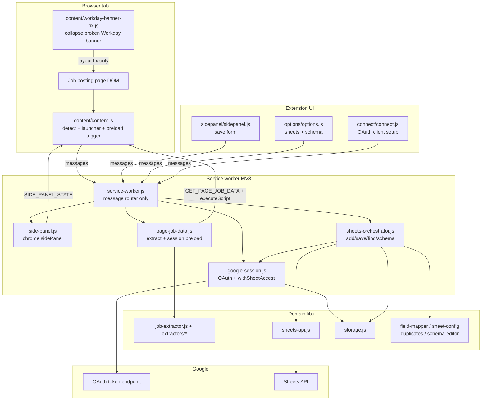
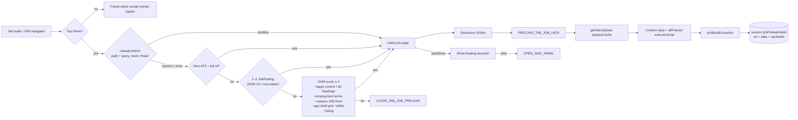
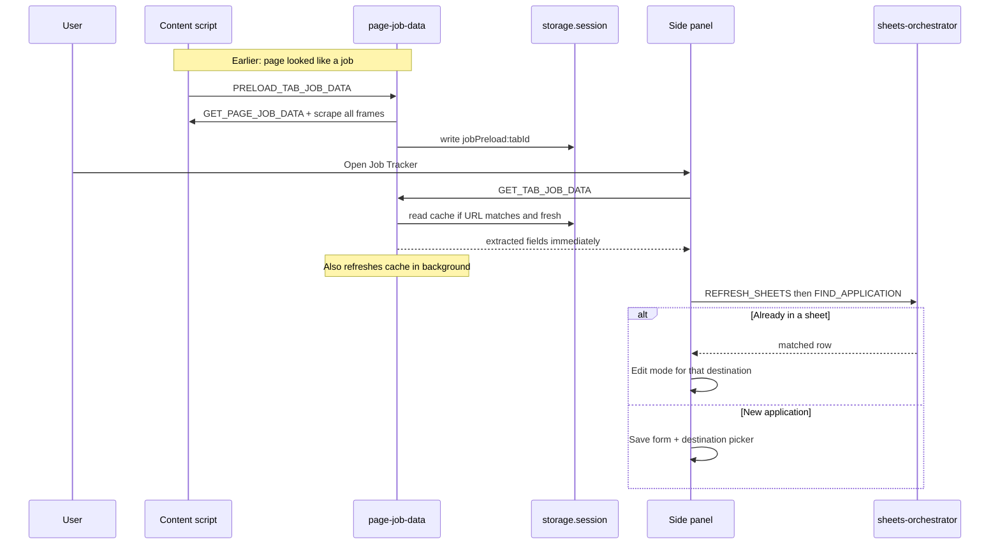
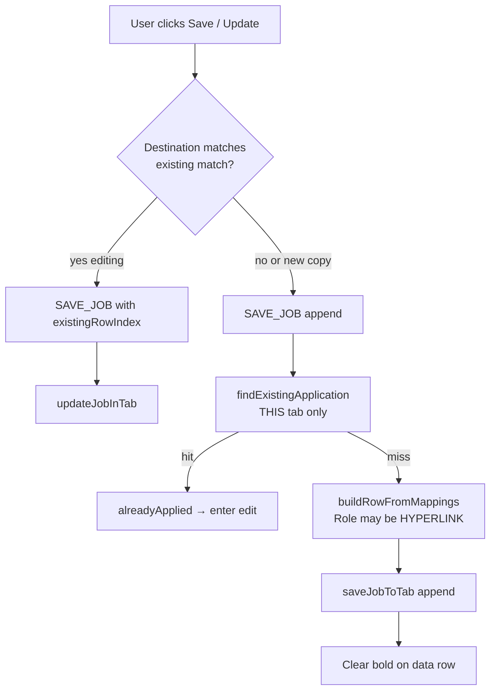
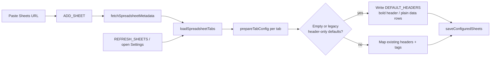
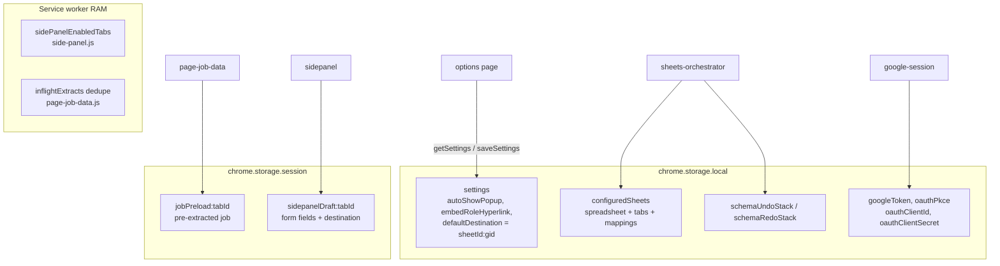

# Job Tracker — how the application works

Detailed Mermaid diagrams of the Chrome MV3 extension architecture.
Render in any Mermaid-aware viewer (GitHub, VS Code preview, etc.).

Kept in sync with the codebase via
[`.cursor/skills/keep-diagrams-updated`](../.cursor/skills/keep-diagrams-updated/SKILL.md).

---

## 1. Big picture — surfaces → service worker → libs → Google



**Rule of thumb:** UI and content never call Google directly. The service worker routes; modules own one duty each (`side-panel`, `google-session`, `page-job-data`, `sheets-orchestrator`).

---

## 2. What happens when you land on a job page



- Detection (`isLikelyJobPage` / `jobPageSignals` in `lib/job-extractor.js`) is platform-general: URL shapes, schema.org JobPosting, and structural DOM signals — no site allow/block lists. Loose body keywords (“job”, “apply”) are never enough on their own, so inboxes and other app shells stay negative.
- Full extract is DOM-only (no network) but heavier — preload only runs on likely job pages. Pipelines: Greenhouse, Workday, Lever, Ashby, SmartRecruiters, LinkedIn, Indeed (`lib/extractors/`), plus the general JSON-LD/DOM strategies (one or two `JobPosting` nodes only) that fill whatever an ATS pipeline missed.
- Cache TTL is 5 minutes; tab close / URL change clears it.
- Launcher CSS is injected via `manifest.json` `content_scripts.css` (CSP-safe); AutoShow is Settings → “Show Job Tracker button on job pages”.
- Content script is a **classic** (non-module) bootstrap with dynamic `import()` of libs. A general URL helper (`lib/job-page-url.js` → `classifyJobUrl` / `urlLooksLikeJobPosting`) short-circuits on posting-shaped URLs (job word + id/slug, job-id query params, jobs/careers hosts + id), then full DOM detection refines.

---

## 3. Opening the side panel (preload fast path)



**Still can wait on:** Google auth + refreshing sheet config + duplicate search. Preload only removes the **page scrape** wait.

---

## 4. Auth and Sheets access

```mermaid
flowchart TB
  UI[Side panel / Options / Connect] -->|GET_AUTH_STATUS or SIGN_IN| Auth[google-session.js]

  Auth --> setup{OAuth client configured?<br/>stored client or packed default}
  setup -->|no| Connect[Set up Google page<br/>SAVE_OAUTH_CLIENT]
  setup -->|yes| token{Access token fresh?}

  token -->|yes| call[withSheetAccess fn token]
  token -->|no| refresh[Silent refresh with refresh_token]
  refresh -->|ok| saveTok[save googleToken in local storage]
  saveTok --> call
  refresh -->|no refresh token or revoked| signin[Sign in required<br/>user clicks Sign in]
  signin --> interactive[launchWebAuthFlow<br/>auth code + PKCE]
  interactive --> saveTok

  call --> API[lib/sheets-api.js fetch]
  API -->|401| once[Drop access token, refresh once, retry]
  API --> Sheets[sheets.googleapis.com]
  interactive -.-> OAuth[accounts.google.com / oauth2.googleapis.com]
  refresh -.-> OAuth
```

- `SIGN_OUT` only clears the stored token. It does not revoke access at Google and keeps the OAuth client settings and connected sheets.
- The redirect URI is `https://<extension-id>.chromiumapp.org/` and must be listed exactly (trailing slash) on the Web-application OAuth client.

---

## 5. Saving / updating / copying to another sheet



- **Open-panel FIND** searches **all** connected sheets.
- **Append** duplicate check is **per destination**, so the same job can be copied to another sheet/tab.

---

## 6. Connecting a Google Sheet



Default columns: Date Applied, Job ID, Company Name, Role, Location, Application Status (URL lives in the Role hyperlink).

---

## 7. Where state lives



---

## Mental model

| Piece | Job |
|--------|-----|
| **Content script** | Detect single postings (`classifyJobUrl` / `isLikelyJobPage`), show launcher, ask for preload, answer scrape requests |
| **job-extractor + extractors/\*** | ATS pipelines (incl. LinkedIn, Indeed) + general JSON-LD/DOM fusion |
| **Side panel** | Human form: review fields, pick sheet, save/update/delete |
| **Options** | Connect spreadsheets, edit columns/types/dropdown choices, undo/redo, sign in/out, prefs |
| **Connect** (“Set up Google”) | OAuth client setup (Advanced, only when no built-in client) and troubleshooting |
| **Service worker** | Traffic cop — routes messages, doesn’t own business logic |
| **page-job-data** | Scrape tabs + session preload cache |
| **google-session** | Sign-in and fresh tokens for Sheets |
| **sheets-orchestrator** | All spreadsheet workflows |
| **lib/\*** | Pure domain rules (extract, map, dupe, schema, HTTP) |

See also `.cursor/skills/separation-of-duty/SKILL.md` for the layer ownership map and canonical message types.
