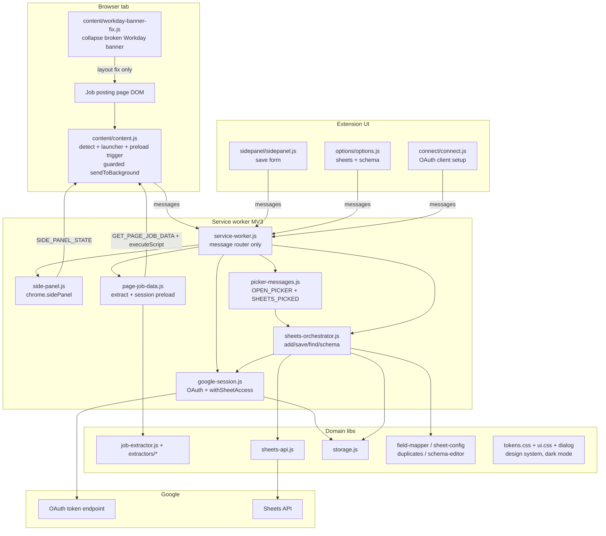
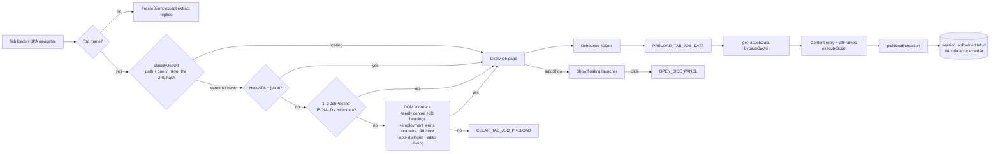
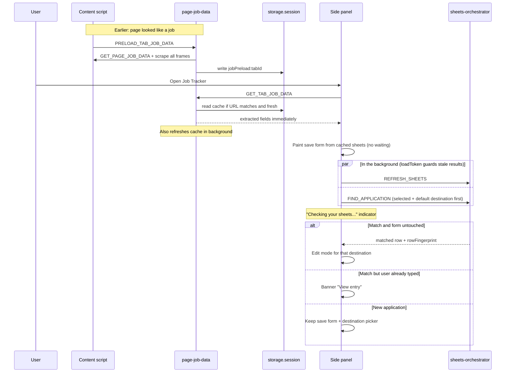
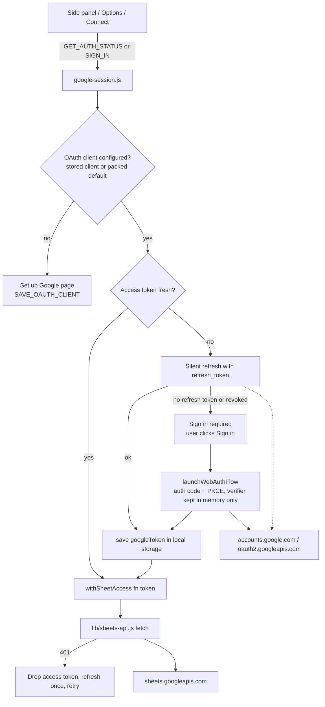
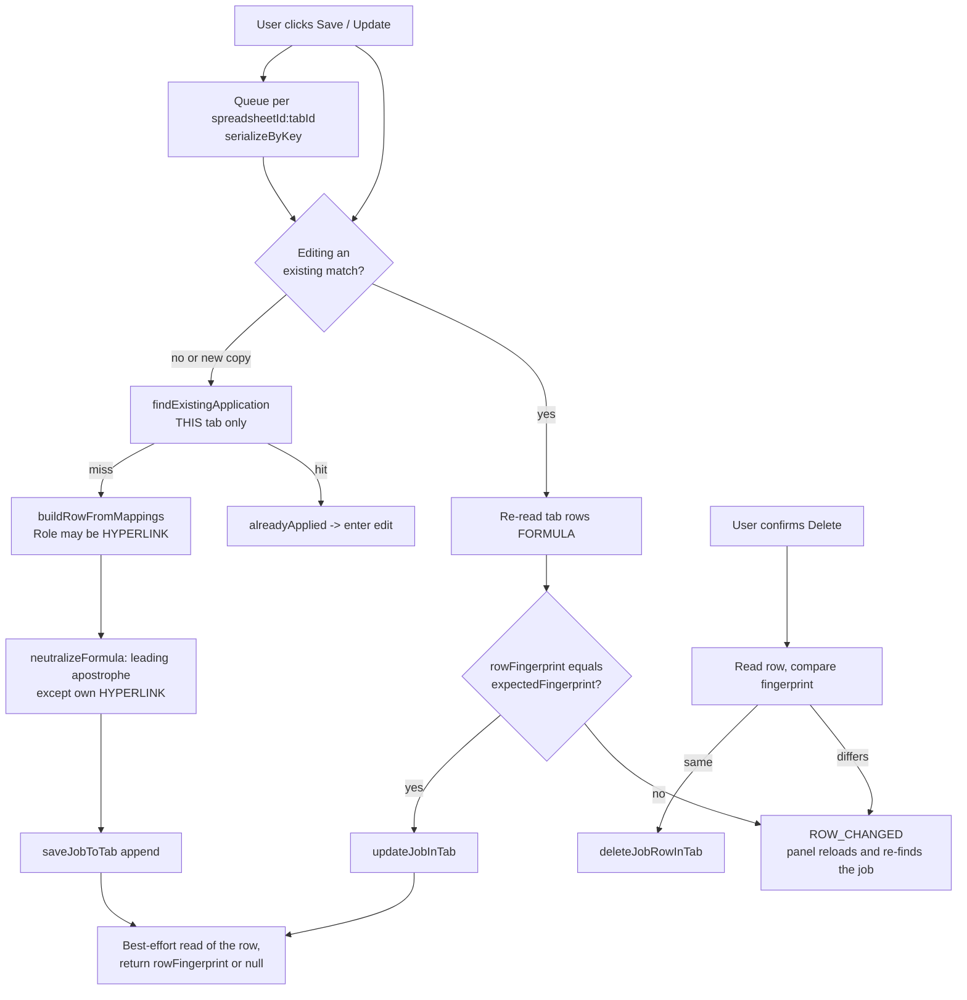
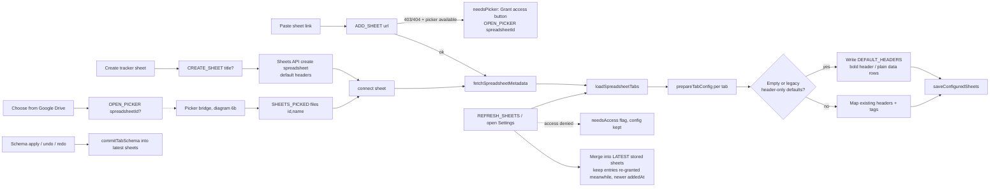
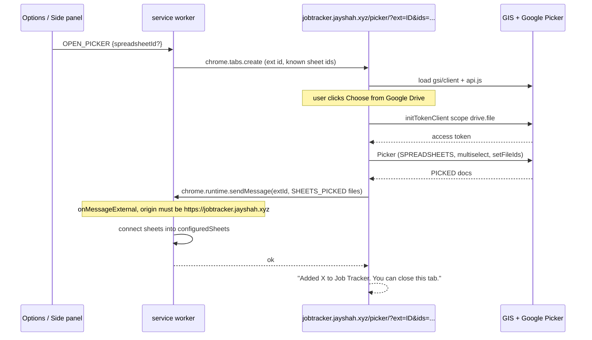
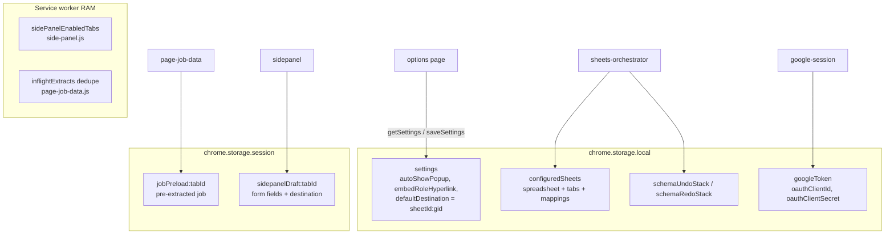
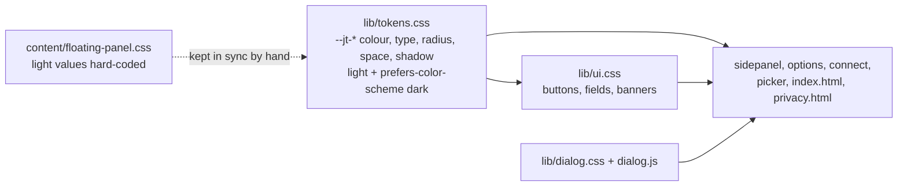

# Job Tracker — how the application works

Detailed Mermaid diagrams of the Chrome MV3 extension architecture.
Render in any Mermaid-aware viewer (GitHub, VS Code preview, etc.).

Kept in sync with the codebase via
[`.cursor/skills/keep-diagrams-updated`](../.cursor/skills/keep-diagrams-updated/SKILL.md).

---

## 1. Big picture — surfaces → service worker → libs → Google

The hosted `picker/` page is outside the extension (diagram 6b). `sidepanel/sheet-access.js` is the shared add-sheet controller used by the side panel and Settings. Pages style themselves with `lib/tokens.css` / `lib/ui.css`; only the floating launcher keeps hard-coded light values.

**Rule of thumb:** UI and content never call Google directly. The service worker routes; modules own one duty each (`side-panel`, `google-session`, `page-job-data`, `sheets-orchestrator`).

---

## 2. What happens when you land on a job page

- Detection (`isLikelyJobPage` / `jobPageSignals` in `lib/job-extractor.js`) is platform-general: URL shapes, schema.org JobPosting, and structural DOM signals — no site allow/block lists. Loose body keywords (“job”, “apply”) are never enough on their own, so inboxes and other app shells stay negative.
- Full extract is DOM-only (no network) but heavier — preload only runs on likely job pages. Pipelines: Greenhouse, Workday, Lever, Ashby, SmartRecruiters, LinkedIn, Indeed (`lib/extractors/`), plus the general JSON-LD/DOM strategies (one or two `JobPosting` nodes only) that fill whatever an ATS pipeline missed.
- Cache TTL is 5 minutes; tab close / URL change clears it.
- Launcher CSS is injected via `manifest.json` `content_scripts.css` (CSP-safe); AutoShow is Settings → “Show Job Tracker button on job pages”.
- Content script is a **classic** (non-module) bootstrap with dynamic `import()` of libs. A general URL helper (`lib/job-page-url.js` → `classifyJobUrl` / `urlLooksLikeJobPosting`) short-circuits on posting-shaped URLs (job word + id/slug, job-id query params, jobs/careers hosts + id), then full DOM detection refines.

---

## 3. Opening the side panel (preload fast path)

The form never waits on Google: only the match banner / edit mode depends on the search. Preload removes the **page scrape** wait. Rows are read in 500-row chunks.

---

## 4. Auth and Sheets access

- The PKCE verifier lives only in the service worker's memory for the duration of the sign-in; nothing PKCE-related is stored.
- `SIGN_OUT` only clears the stored token. It does not revoke access at Google and keeps the OAuth client settings and connected sheets.
- The redirect URI is `https://<extension-id>.chromiumapp.org/` and must be listed exactly (trailing slash) on the Web-application OAuth client.
- A stored token without `drive.file` (old broad scope) is dropped: `GET_AUTH_STATUS` returns `scopeOutdated: true` and the UI asks the user to sign in again.
- The only scope is `drive.file` (non-sensitive): the token can touch only spreadsheets the app created or the user picked.

---

## 5. Saving / updating / deleting / copying to another sheet

- Saves are serialized per `spreadsheetId:tabId`, so a double click or two panels cannot both pass the duplicate check. Schema apply/undo/redo share one separate queue. Rows read back have the apostrophe text marker stripped (`stripTextMarker`), including for duplicate matching.
- **Open-panel FIND** searches **all** connected sheets.
- **Append** duplicate check is **per destination**, so the same job can be copied to another sheet/tab.
- A match requires URL, then job id, then company + role; an id-only match is skipped when both companies are present and clearly different (`companiesClearlyDiffer`).
- A null `rowFingerprint` (read-back failed) means the panel sends no `expectedFingerprint` on its next Update, so that one check is skipped rather than failing.
- The header row (row 0) can never be updated or deleted.
- Saving to a destination flagged `needsAccess` is refused in the panel with a Grant access message (no request is sent).

---

## 6. Connecting a Google Sheet

`REFRESH_SHEETS` and the schema handlers never save their starting snapshot: they merge into the latest stored sheets (`addedAt` is strictly increasing on reconnect, so a sheet re-granted during a refresh is kept). In the side panel destination menu, `needsAccess` tabs show "(needs access)" and are skipped for the default or first selection.

Default columns: Date Applied, Job ID, Company Name, Role, Location, Application Status, Notes (URL lives in the Role hyperlink).

---

## 6b. Picker bridge (Choose from Google Drive)

Google Picker can't load in an MV3 extension page, so it runs on a hosted page and hands the result back with external messaging.

- Picker and extension must belong to the **same Cloud project**, or `drive.file` access is not granted to the extension's client.
- Custom OAuth clients only get **Create tracker sheet** (`pickerAvailable` is false in `GET_AUTH_STATUS`).
- Non-Chromium browsers have no `chrome.runtime`; the page shows a message and a **Try again** button.

---

## 7. Where state lives

---

## 8. Design tokens and theming

- Dark mode follows the system (`:root:not([data-theme='light'])`). The launcher runs inside host pages, cannot load the tokens file, and stays light.

---

## Mental model

| Piece | Job |
|--------|-----|
| **Content script** | Detect single postings (`classifyJobUrl` / `isLikelyJobPage`), show launcher, ask for preload, answer scrape requests |
| **job-extractor + extractors/\*** | ATS pipelines (incl. LinkedIn, Indeed) + general JSON-LD/DOM fusion |
| **Side panel** | Human form: review fields, pick sheet, save/update/delete |
| **Picker page** (`picker/`, hosted) | Google Picker + `SHEETS_PICKED` hand-off |
| **picker-messages** | `OPEN_PICKER`, validates and handles external `SHEETS_PICKED` |
| **sheet-access** (`sidepanel/`) | Shared Create / Choose / Grant access controller for panel and Settings |
| **Options** | Create/choose spreadsheets, edit columns/types/dropdown choices, undo/redo, sign in/out, prefs |
| **Connect** (“Set up Google”) | OAuth client setup (Advanced, only when no built-in client) and troubleshooting |
| **Service worker** | Traffic cop — routes messages, doesn’t own business logic |
| **page-job-data** | Scrape tabs + session preload cache |
| **google-session** | Sign-in and fresh tokens for Sheets (`drive.file`) |
| **sheets-orchestrator** | All spreadsheet workflows |
| **lib/\*** | Pure domain rules (extract, map, dupe, schema, HTTP) |

See also `.cursor/skills/separation-of-duty/SKILL.md` for the layer ownership map and canonical message types.
